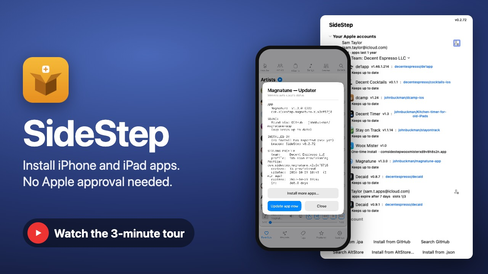

<p align="center">
  
</p>

<h1 align="center">SideStep</h1>

<p align="center"><b>Install iPhone and iPad apps on your own devices. No Apple approval needed.</b></p>

<p align="center">
  <a href="https://github.com/johnbuckman/SideStep/releases"><b>Download for Mac</b></a> ·
  <a href="https://johnbuckman.github.io/SideStep/">Website</a> ·
  <a href="https://johnbuckman.github.io/SideStep/help.html">The full guide</a> ·
  <a href="https://youtu.be/MM5PfgjOk8E">Video tour</a>
</p>

<p align="center">
  <a href="https://youtu.be/MM5PfgjOk8E"></a>
</p>

SideStep is a small, free **macOS menu-bar app** that installs iOS apps onto your own iPhone or
iPad, signed with your own Apple ID (a free one works), and then **keeps them signed and up to
date by itself**, over a cable or over Wi-Fi. No jailbreak, no special hardware. macOS 14 or
newer, Apple silicon or Intel.

- **Apps the App Store won't carry**: open-source apps, your own apps, apps with features Apple
  tends to reject.
- **Keep old devices useful**: apps the App Store has dropped for older iPhones and iPads.
- **Updates without a review queue**: new versions reach your devices within a day.
- **Everything stays local**: your Apple ID, your Mac, your device. No SideStep account or server.

**How it works, in short:** sign in with an Apple ID; plug in your iPhone and turn on Developer
Mode; pick an app from the curated AltStore catalogs, a GitHub project or an `.ipa` file; trust
your Apple ID on the device once. From then on SideStep renews your apps before they expire and
installs new versions, and each app checks in with your Mac over Wi-Fi by itself. Everything is
explained step by step, with pictures, in **[the guide](https://johnbuckman.github.io/SideStep/help.html)**
(also as plain Markdown: [`docs/GUIDE.md`](docs/GUIDE.md)).

**For app developers:** [SideStep Wizard](https://johnbuckman.github.io/SideStepWizard/) turns
your GitHub project into a one-click installer anyone can open, plus a ready-made button for
your website.

**Not for piracy:** the catalog is curated by pull request, known pirate sources and pirated
builds are refused, and SideStep asks before installing anything that looks like a paid App
Store app. See [`blocklist.json`](blocklist.json).

## Build

```
swift build --product InstallerApp   # the menu-bar app
swift build --product Provision       # the command-line tool (install / refresh)
```

`./bundle-app.sh` builds and bundles the menu-bar app into `SideStep.app`. The
device tools (a small [libimobiledevice](https://github.com/libimobiledevice/libimobiledevice)
helper in [`Helpers/idevice`](Helpers)) ship inside the app, so it's self-contained
— no Python or external tools required at runtime.

**Regression tests:** `./regression/regress.sh` runs an automated suite that verifies
installs actually land, uninstalls remove, versions match, extensions install, App IDs
are reused, and the on-device beacon responds — asserted against the device itself, not
SideStep's own success message. See [`docs/REGRESSION-TESTS.md`](docs/REGRESSION-TESTS.md).

**Driving SideStep by script** (screenshots, videos, tests): a token-gated debug control
channel, off by default. See [`docs/DEBUG-CONTROL.md`](docs/DEBUG-CONTROL.md).

Contributing, or an AI agent picking up the project? Start with
[`docs/AI-BOOTSTRAP.md`](docs/AI-BOOTSTRAP.md), then
[`docs/CURRENT-STATE.md`](docs/CURRENT-STATE.md).

## Credits & license

Built on **[AltSign]** from the **[AltStore]** / **[SideStore]** projects (© Riley
Testut and contributors), licensed **AGPL-3.0**. As a derivative work, SideStep is
likewise licensed under the **GNU Affero General Public License v3.0** — see
[`LICENSE`](LICENSE). The signer is **[zsign]** by zhlynn, included under the **MIT
License** (see [`Dependencies/zsign`](Dependencies/zsign)).

[AltSign]: https://github.com/SideStore/AltSign
[AltStore]: https://github.com/altstoreio/AltStore
[SideStore]: https://github.com/SideStore/SideStore
[zsign]: https://github.com/zhlynn/zsign
